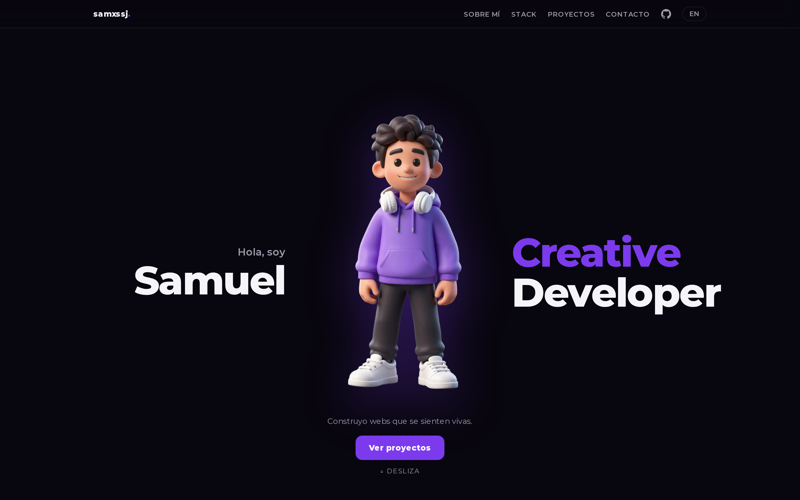

# samxssj-portfolio

Personal developer portfolio built with Next.js — bilingual (ES/EN), interactive 3D hero, and a working contact form. Built with a focus on performance, accessibility and clean motion.

**Live:** https://samxssj-portfolio.vercel.app



## Tech stack

| Area | Technologies |
|---|---|
| Framework | Next.js 16 (App Router, RSC, Server Actions) · TypeScript (strict) |
| Styling | Tailwind CSS v4 · Montserrat (`next/font`) |
| 3D | Three.js · `@react-three/fiber` · `@react-three/drei` |
| i18n | `next-intl` (Spanish / English routing) |
| Contact | Server Action + Zod validation · Resend (Nodemailer fallback) |
| Testing | Vitest (unit) · Playwright (e2e smoke) |
| Deploy | Vercel |

## Features

- **Bilingual** ES/EN with locale-based routing (`next-intl`).
- **Interactive 3D** hero powered by react-three-fiber (procedural keyboard + parallax avatar).
- **Contact form** with schema validation (Zod) and transactional email (Resend).
- **Typed content layer** (`content/`) for projects and stack, covered by unit tests.
- **Tested**: unit tests for schemas/content plus an e2e smoke test for the golden path.

## Getting started

```bash
npm install
cp .env.example .env.local   # fill in the contact-form values
npm run dev                  # http://localhost:3000
```

## Scripts

```bash
npm run dev        # development server
npm run build      # production build
npm run start      # run production build
npm run lint       # eslint
npm run test       # vitest (unit)
npm run test:e2e   # playwright (e2e)
```

## Environment

See `.env.example` for the full list. The contact form needs an email provider
configured (Resend API key, or SMTP credentials for the Nodemailer fallback).

## License

[MIT](LICENSE) © Samuel Bermúdez
